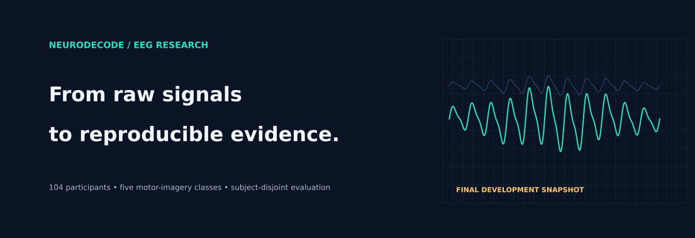
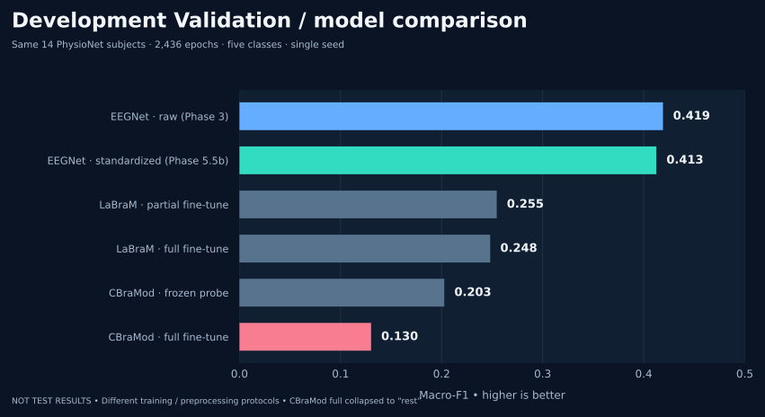
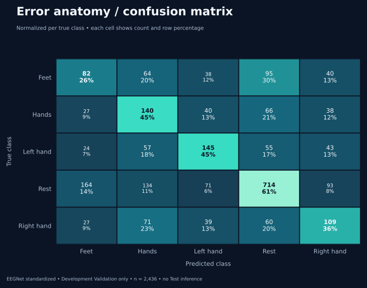
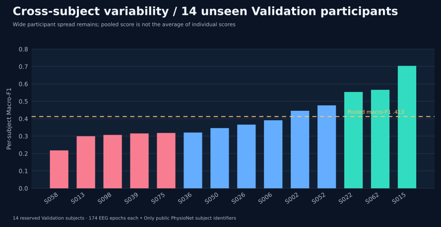

<div align="center">



# NeuroDecode

**A reproducible, evidence-first study of five-class EEG motor imagery**  
*Classical baselines · CNNs · genuine pretrained EEG foundation models · subject-disjoint evaluation*

[**Results & figures**](docs/visualization-gallery.md) · [**Scientific conclusion**](docs/final-research-snapshot.md) · [**Methods & data**](docs/phase2-data-audit.md) · [**Reproducibility**](docs/reproducibility.md) · [**Model card**](docs/model-card.md)

[](https://github.com/mohamad679/labram-mi-project/actions/workflows/ci.yml)


</div>

> [!IMPORTANT]
> **This research snapshot is closed to further model or random-seed experiments.** The published numbers are independently rechecked **development Validation** or **Train-only cross-validation** results, **not held-out Test scores**. No clinical, diagnostic or deployment claim is made. The 15 original Test subjects were not evaluated in the audited studies.

## Research question

Do *authentically pretrained EEG foundation encoders* outperform compact, EEG-specific approaches on a difficult **subject-independent, five-class** motor-imagery classification task? We studied this using a frozen PhysioNet EEGMMIDB/MOABB cohort, provenance-verified checkpoints and development-only comparisons.

## What the evidence actually shows



| Model / protocol | Development Val. accuracy | **Macro-F1** | Evidence |
|---|---:|---:|---|
| **EEGNet, original protocol** | 47.99% | **0.4191** | [Phase 3](results/validation/phase3_validation_rerun_seed42_20261013.json) |
| EEGNet, standardized per EEG epoch | **48.85%** | **0.4125** | [Phase 5.5b](results/validation/phase55b_one_time_validation_seed42_20261013.json) |
| Pretrained LaBraM, partial adaptation | 38.59% | 0.2546 | [Phase 4](results/validation/phase4_validation_seed42_20261013.json) |
| Pretrained LaBraM, full adaptation | 34.85% | 0.2481 | [Phase 4](results/validation/phase4_validation_seed42_20261013.json) |
| Pretrained CBraMod, frozen probe | 27.79% | 0.2027 | [Phase 5](results/validation/phase5_cbramod_validation_seed42_20261013.json) |
| Pretrained CBraMod, full adaptation | 48.28% | **0.1302** | [Phase 5: single-class collapse](docs/phase5-foundation-comparator.md) |

**Central finding:** The compact EEGNet was the strongest recorded baseline by development-Validation Macro-F1. CBraMod full fine-tuning predicted only `rest` despite its superficially reasonable accuracy; it therefore **failed as a movement classifier**. These are concrete outcomes of these **specific** adapters and budgets, not universal model rankings.

The separate 75-Train-subject, three-fold candidate screen preferred normalized EEGNet (**0.3912 Train OOF Macro-F1**, versus **0.3212** for raw EEGNet under its matched Train-only protocol). But the subsequently locked, **one-time** historic Validation assessment returned **0.4125 versus the earlier EEGNet reference 0.4191**. The apparent Train-CV gain **did not translate into a better Validation Macro-F1**. See [the honest conclusion](docs/final-research-snapshot.md).

## The data contract

| Cohort | Signal | Prediction task | Frozen partition |
|---|---|---|---|
| **104 participants** | 64 EEG channels × 400 time points, 160 Hz, prefiltered 8–32 Hz, µV | `feet`, `hands`, `left_hand`, `rest`, `right_hand` | **75 Train** / **14 Validation** / **15 Test, untouched** |

The source consists of **18,096** total imagery/rest epochs from [PhysioNet EEGMMIDB](https://physionet.org/content/eegmmidb/1.0.0/). Dataset identity is fixed by HDF5 SHA-256 `f6d2c7824f6aaa522286ea8ee5253b0220602117fc69d7b49c3af6e6a1324f7a`, with participant assignments in [`configs/phase3_locked_split.json`](configs/phase3_locked_split.json). Raw recordings, derived HDF5 and trained checkpoint binaries are **not stored in Git**.

## Look inside the final model

| Five-class errors | Participant heterogeneity |
|---|---|
|  |  |

The normalized model's subject-cluster bootstrap interval for development-Validation Macro-F1 is **0.349–0.485 (95%, exploratory)**. Scores vary substantially among the 14 held-out development participants; neither the intervals nor a single training seed establish population-level robustness.

**[Explore all seven scientific visualizations →](docs/visualization-gallery.md)**, including per-class F1, checkpoint selection and the Train-only candidate screen. Every chart is linked to a versioned empirical JSON record or the final user-supplied Prediction ZIP hash.

## Reproduce the evidence, not a promised benchmark

This is a **completed, closed research snapshot**, not a new training campaign. The repository retains its source adapters, unit tests, subject-split guards and the Kaggle notebooks used in the documented studies, for inspection of exactly how existing evidence arose. New training, Test inference, automatic reseeding and architecture search are **out of scope**.

```bash
git clone https://github.com/mohamad679/labram-mi-project.git
cd labram-mi-project
python -m pip install "pytest>=8,<9" "numpy>=1.24,<3" "scikit-learn>=1.3,<2" "scipy>=1.14,<2" "h5py>=3.10,<5" "PyYAML>=6,<7"
python -m pytest -q
python -m scripts.check_repository_quality
```

Offline tests check code contracts, **not** medical usability or a fresh end-to-end GPU run. The [study notebooks](notebooks/README.md) pin real runner/source revisions and the input hash; external libraries and official pretrained weights are credited in the [scientific provenance report](docs/final-research-snapshot.md). The archived [Gradio demonstration](results/phase4_gradio_demo.md) is illustrative and requires a separately provided compatible checkpoint.

## Repository guide

| Start with | What you will find |
|---|---|
| [Final research snapshot](docs/final-research-snapshot.md) | Conclusions, limitations, hashes, decisions and closure policy |
| [Results & visualization gallery](docs/visualization-gallery.md) | Accessible SVG charts made from recorded experimental data |
| [Docs index](docs/README.md) | Frozen experiment protocols, checkpoint and preprocessing provenance |
| [Data provenance](docs/phase2-data-audit.md) | The actual 104-participant EEGMMIDB/MOABB data contract |
| [Model card](docs/model-card.md) | What the models do, what they do **not** establish |
| [Research integrity audit](docs/research-audit.md) | Why older historical metrics are preserved separately |

## Responsible use and credit

This project is **research and educational software only**. Attention rollout and post-hoc MC Dropout are exploratory visual inspection techniques, **not validated cortical attribution, calibrated uncertainty or clinical guidance**. Earlier, unverified historical results are preserved as legacy material and never mixed into the independently audited model comparison.

Original EEG recordings: [PhysioNet EEGMMIDB](https://physionet.org/content/eegmmidb/1.0.0/) · Research stack: [MOABB](https://moabb.neurotechx.com/), [Braindecode](https://braindecode.org/) and PyTorch. LaBraM/CBraMod weights remain their respective upstream works. **No license for the repository's original code has been chosen by the owner:** public readability does not automatically grant reuse rights. See [SECURITY.md](SECURITY.md).