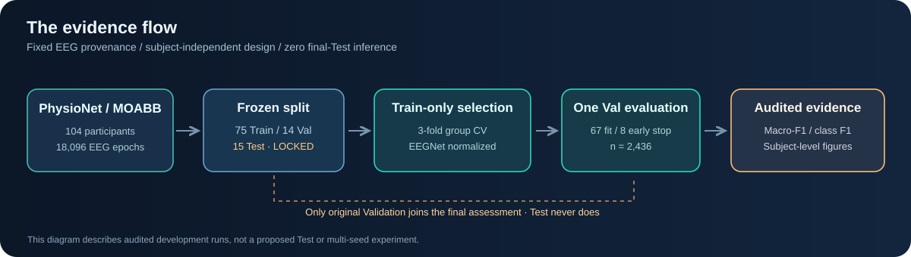
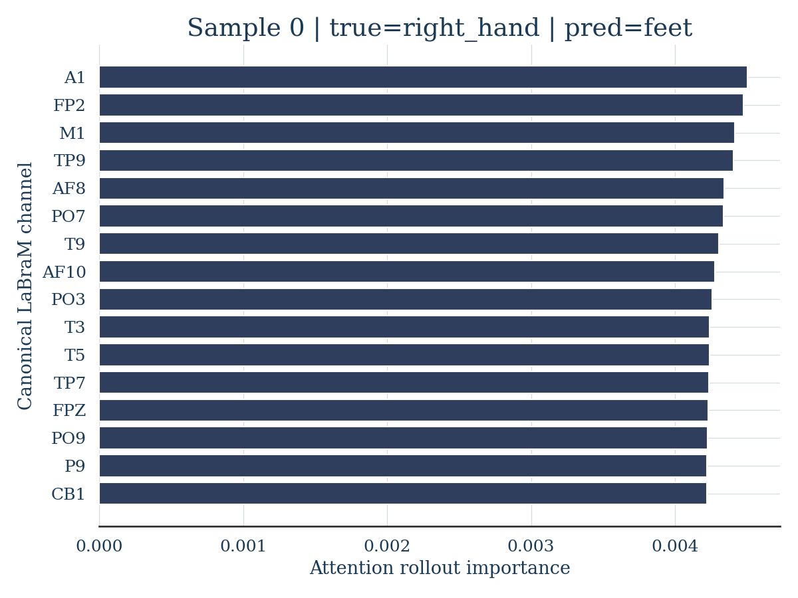
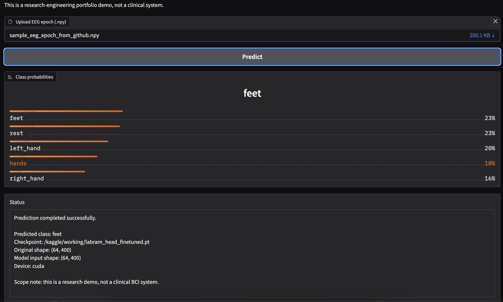

# NeuroDecode-LaBraM

**EEG motor-imagery decoding, model uncertainty and attention-based inspection — with explicit scientific limitations.**

**Explore:** [Documentation](docs/README.md) · [Architecture](docs/architecture.md) · [Verified-figure gallery](docs/visualization-gallery.md) · [Release readiness](docs/release-readiness.md)

[](https://www.python.org/)
[](https://pytorch.org/)
[](#at-a-glance)

> **Transparency note:** The original repository described LaBraM *fine-tuning*, but the archived training source instantiated `InterpolatedLaBraM` without an explicit pretrained-weight load. **The provenance of historical checkpoints is unverified.** Historical scores below are retained for traceability, not represented as confirmed pretrained-model benchmarks. See [Research audit](docs/research-audit.md).



## At a glance

| Component | Implementation | Status |
| --- | --- | --- |
| Dataset | PhysioNet Motor Movement/Imagery through MOABB | Existing pipeline |
| Subject holdout | 75 train / 14 validation / 15 test subjects, reported | Group-disjoint split; offline tests added |
| Classifier | LaBraM architecture with 5 motor imagery classes | New pretrained 400-sample weight adapter CPU-tested; historical metrics unverified |
| Uncertainty | MC Dropout, entropy and BALD | Exploratory; post-hoc dropout needs validation |
| Explainability | Transformer attention rollout | Model inspection, **not** clinical explanation |
| Interactive demo | Gradio: classify, uncertainty, explain | Requires a compatible local checkpoint |
| Reproducibility | YAML training, pinned checkpoint verification and held-out subject metadata | Full multi-seed GPU rerun **not yet verified** |

## Visual overview

| EEG channel inspection | Interactive prediction |
| --- | --- |
|  |  |

[Watch the recorded Gradio dashboard](results/figures/phase4_gradio_demo/gradio_dashboard_demo.mp4) (video, ~24 MB).

### Historical results (not revalidated after refactor)

| Archived experiment | Accuracy | Macro-F1 |
| --- | ---: | ---: |
| Head-only baseline (representative run) | 0.357 | 0.193 |
| MC Dropout (archived run) | 0.3065 | 0.1860 |

These are **different evaluations**, not evidence that dropout improves performance. A five-class chance-level reference is 20% accuracy under uniform guessing; imbalance and subject heterogeneity limit that comparison. [Original full report](docs/legacy-project-report.md) · [Phase 1](results/phase1_baseline.md) · [Phase 2](results/phase2_uncertainty.md) · [Phase 3](results/phase3_attention_rollout.md).

## Kaggle S3-only data preparation

When PhysioNet direct downloading is slow, the [CPU-only Amazon S3 cache builder](docs/kaggle-s3-cache.md) prepares a resumable 104-participant HDF5 cache on Kaggle. Its separate helper CLI is [scripts/prepare_physionet_s3.py](scripts/prepare_physionet_s3.py). The real 104-subject S3 run is **not yet validated**; Kaggle outputs must be saved explicitly and remain private as appropriate.

## Kaggle full-data experiments

**[Open the full Kaggle GPU experiment notebook](run_kaggle.ipynb)** · [Step-by-step Kaggle guide](docs/kaggle-experiment.md)

The notebook runs one full-cohort experiment per session: pinned Pretrained or Scratch with a fixed subject split, saved model/seed metadata, real held-out classification metrics and participant-level confidence intervals. The Notebook code has offline syntax checks; **a complete Kaggle GPU training run has not yet been independently validated.**

## Quick start

Requires Python 3.10+, an appropriate environment for PyTorch/Braindecode, and permitted access to PhysioNet data.

```bash
git clone https://github.com/mohamad679/labram-mi-project.git
cd labram-mi-project
python -m venv .venv
source .venv/bin/activate
python -m pip install -r requirements.txt
python -m src.train --config configs/baseline.yaml
```

Windows activation: `.venv\Scripts\activate`. Training can be resource-intensive and may download EEG recordings through MOABB; see [Reproducibility guide](docs/reproducibility.md) before use. Dependency ranges are bounded but **not** a lockfile.

**Crucial:** `configs/baseline.yaml` defaults to `model_init: scratch` to make initialization unambiguous. This configuration does **not** claim pretrained LaBraM results. To attempt *pretrained* fine-tuning, set `model_init: pretrained`, a verified `pretrained_repo_id` and an immutable 40-character `pretrained_revision`. See the [checkpoint audit](docs/reproducibility.md#auditing-pretrained-weights-network-required). The pinned official pretrained backbone and 400-sample temporal-prefix adapter passed an actual CPU tensor identity and synthetic forward-pass audit; **historical scores remain unverified**. See [Phase 3 validation](docs/phase3-validation.md).

After successful training, a checkpoint is written to `checkpoints/labram_head_finetuned.pt` (gitignored), with metadata in a sibling JSON file. A separate `checkpoints/heldout_predictions.npz` artifact supports evidence-backed benchmark figures. Run:

```bash
python -m src.uncertainty
python -m src.explain
python app.py
```

The latter commands require the trained checkpoint and data cache. The Gradio demo accepts a single `.npy` EEG epoch with shape `(64,400)`, `(1,64,400)`, or `(400,64)`. Model output **must not** be used for patient care, accessibility decisions or clinical advice.

### Reproducible multi-seed campaigns

The [Phase 5 execution guide](docs/phase5-experiment-execution.md) provides a separately pinned pretrained configuration, a real-data CPU training smoke test, a fixed `split_seed`, and a three-seed full-data experiment launcher. **The launcher does not claim that a full training experiment has been run.**

```bash
python -m scripts.run_multiseed --config configs/pretrained_labram.yaml --seeds 42 123 2025
```

This command only prepares experiment plans. Full training requires a configured GPU/data environment and an explicit `--execute` flag. Subject-cluster confidence intervals are generated from real held-out predictions with `python -m scripts.subject_confidence --predictions <path/to/heldout_predictions.npz>`.

## Project layout

```text
app.py                    Gradio proof-of-functionality demo
configs/baseline.yaml     Authoritative training settings
src/config.py             YAML validation
src/data.py               Data access and subject-wise splitting
src/model.py              LaBraM architecture; optional explicit pretrained source
src/train.py              Linear-probe training and run metadata
src/uncertainty.py        Exploratory MC Dropout analysis
src/explain.py            Attention rollout research inspection
src/evaluate.py           Accuracy, F1 and calibration helpers
tests/                    Offline split and configuration checks
results/                  Archived reports and representative figures
docs/                     Methodology, research caveats and setup
run_kaggle.ipynb          Kaggle execution launcher
```

**Independent research checks:** [Pretrained 400-sample transfer and forward pass](https://github.com/mohamad679/labram-mi-project/actions/runs/38234001055) passed on CPU. [Real EEG preprocessing equivalence](https://github.com/mohamad679/labram-mi-project/actions/runs/38234916355) passed on PhysioNet subject 1 with zero numerical difference after unit conversion. These are **not** model-accuracy benchmarks.

## Quality checks

Run the fast offline tests without downloading EEG data:

```bash
python -m pip install pytest PyYAML numpy scikit-learn
python -m pytest -q
```

CI runs the offline tests and Python compilation on proposed changes. These checks do **not** prove the full training and visualization stack works on GPU.

## Research integrity

- **Data splitting:** subject-disjoint `GroupShuffleSplit`; verify the same patient is not in multiple partitions.
- **Pretraining:** explicit model source required for new pretrained runs. **Never infer pretrained weights from a class name.**
- **Uncertainty:** post-hoc dropout changes model behavior; BALD is exploratory until methodologically validated.
- **Interpretability:** attention is not a causal explanation and attention channel importance is not verified EEG physiology.
- **Limitations:** weak archived macro-F1 and a small sample of rollout visualizations. No production or clinical readiness.
- **Licensing:** no license for this repository's original code has yet been selected. The upstream library license is not automatically a license for this project.

[Benchmarking & figures](docs/benchmarking.md) · [Full research audit](docs/research-audit.md) · [Phase 3 validation](docs/phase3-validation.md) · [EEG data provenance](docs/eeg-data-provenance.md) · [Reproducibility](docs/reproducibility.md) · [Model card](docs/model-card.md) · [Contribution guide](CONTRIBUTING.md)

## Credit

LaBraM architecture: Jiang et al., *Large Brain Model for Learning Generic Representations with Tremendous EEG Data in BCI* (ICLR 2024). Software ecosystem: [Braindecode](https://braindecode.org/), [MOABB](https://moabb.neurotechx.com/) and [PhysioNet EEGMMIDB](https://physionet.org/content/eegmmidb/1.0.0/).

This project is an independent research-engineering implementation, not an official Braindecode or PhysioNet release.
