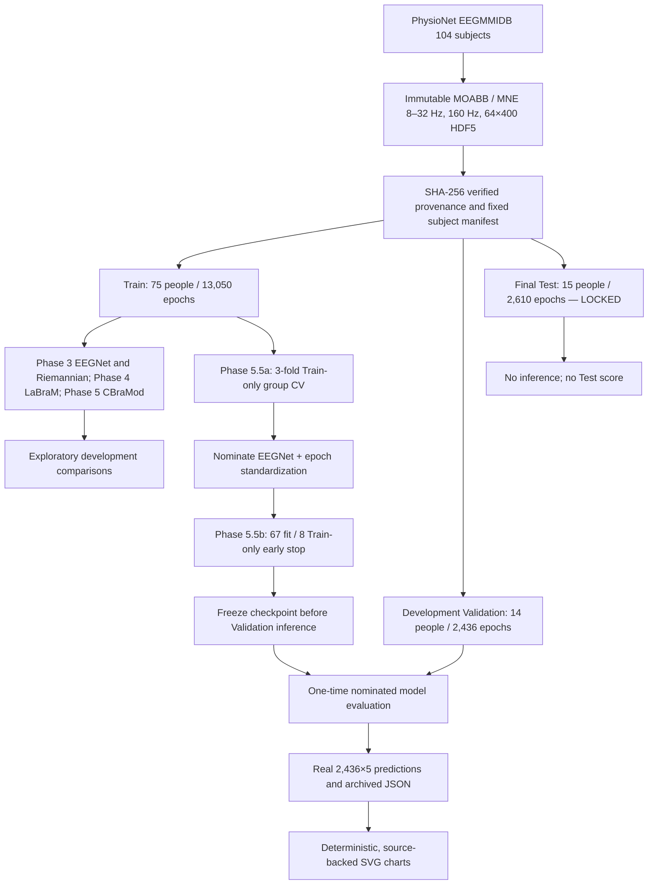

# Final architecture and scientific data-flow boundaries

**This is a frozen development research snapshot.** The diagram describes **what was actually completed**, including Train-only selection and one-time development Validation. The 15 original Test participants were never evaluated.

The subject split remains **the same across recorded experiments**. The historical exploratory Phase 3–5 candidate comparisons used original development Validation during their own checkpoint selection, and are **not independent Test estimators**. Phase 5.5a addressed repeated candidate selection by screening four fixed candidate settings only on Train subjects. Phase 5.5b fit **one** Train-selected model, chose its epoch on a separate eight-person Train subset, then produced the final recorded development Validation evaluation. No further runs are authorized.

## Code and evidence map

| Component | Responsibility | Limit |
| :-- | :-- | :-- |
| [`src/data.py`](../src/data.py), [`src/portable_eeg.py`](../src/portable_eeg.py) | Source epochs, 64-channel order, portable HDF5 schema | Exact upstream MOABB/MNE version and recorded hash required |
| [`src/phase55_trainonly.py`](../src/phase55_trainonly.py) | Subject-group CV and per-epoch normalization | Train-only selection; not a Test estimate |
| [`src/phase55b_protocol.py`](../src/phase55b_protocol.py) | Immutable nominated model and 67/8 split | Denies Test waveform access |
| [`scripts/run_phase55b_validation.py`](../scripts/run_phase55b_validation.py) | One-time nominated EEGNet Validation runner | User-run record completed; no plans to rerun |
| [`src/model.py`](../src/model.py), [`src/phase5_cbramod.py`](../src/phase5_cbramod.py) | Authentic pretrained adapters | Different input transfer domains; only development benchmarks |
| [`results/validation/`](../results/validation/README.md) | Machine-readable audited scientific evidence | No HDF5 or checkpoint binaries in Git |
| [`scripts/render_final_figures.py`](../scripts/render_final_figures.py) | Deterministic SVG visualization **without fitting** | Reads only committed summary JSON |
| [`src/explain.py`](../src/explain.py), [`src/uncertainty.py`](../src/uncertainty.py), [`app.py`](../app.py) | Historical interpretability, uncertainty and Gradio demo | Not causal, calibrated, distributed-model-ready or clinical |

## Security, ethics and distribution

No clinical claims. The original HDF5 and pretrained/fine-tuned weight files are not source-controlled; patient/participant-associated epoch records remain governed by their own source access terms. **Source-code license selection remains outstanding.** The project is an archival research implementation, not a device, service or production inference API.

[Final scientific conclusions](final-research-summary.md) · [Reproducible figures](visualization-gallery.md) · [Archive status](release-readiness.md)
