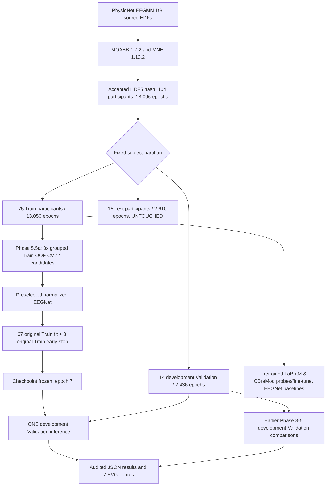

# Study architecture — what was actually run

**Completed development-only research snapshot (2026-10-13).** The same accepted 104-subject PhysioNet EEGMMIDB cache and immutable subject partition were used for all audited study phases. The 15-person **Test remains locked** and is **not** a predecessor of any plotted metric.

**Not executed:** No arrow from the Test group to training, checkpoint selection, Validation metric computation, or the showcase figures. The snapshots are not a confirmatory final-Test study.

## What the code does

| Layer | Owned by | Verified boundary |
|---|---|---|
| EEG collection and data contracts | `src/data.py`, `src/eeg_protocol.py`, `src/portable_eeg.py`, `src/channels.py` | Input units, channel order, 8–32 Hz band, frozen sample/subject hashes |
| Frozen split and leakage checks | `scripts/run_phase3_validation.py`, `configs/phase3_locked_split.json` | Exactly 75/14/15 group-disjoint participants |
| Scratch and pretrained model adapters | `src/model.py`, `src/phase5_cbramod.py`, `src/phase55_trainonly.py` | Authentic foundation-weight provenance, deterministic adaptation |
| Subject-aware Train-only candidate screen | `scripts/run_phase55_trainonly_cv.py` | No historical Validation or Test EEG used in model choice |
| Final one-time normalized EEGNet fit | `src/phase55b_protocol.py`, `scripts/run_phase55b_validation.py` | Fixed candidate; 67/8 Train fit/early-stop and then one 14-subject Validation evaluation |
| Numerical uncertainty / visualization | `src/subject_statistics.py`, `assets/figures/*.svg` | Subject bootstrap exploratory only; figures from recorded, real predictions |
| Experimental legacy (not final metric evidence) | `src/uncertainty.py`, `src/explain.py`, `app.py` | Requires separate checkpoint; attention and MC Dropout not clinical attribution |

## Scientific hazards not hidden by the pipeline diagram

1. **Same-cohort Validation has been inspected repeatedly.** Even with subject-disjoint groups, no untouched final-Test performance estimate was produced.
2. **Model inputs and optimization differ.** LaBraM's temporal patch crop and CBraMod's 200-Hz / zero-padded adapter make the multi-model comparison practical and descriptive, not an architecture-only ablation.
3. **Selection bias persists.** The single normalized candidate was selected on a Train-only OOF screen, but the screen has one seed and fixed folds; per-subject bootstrap intervals do not replace multi-seed replication.
4. **The old Gradio/MC Dropout/attention demo is not a verified final model release.** Keep it separate from audited model figures.

Detailed evidence: [final research snapshot](final-research-snapshot.md) and [visualization gallery](visualization-gallery.md).
