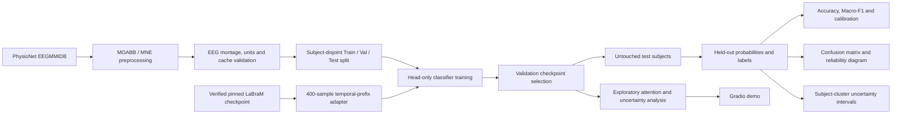

# System architecture and data flow

The pipeline separates public EEG ingestion, subject-disjoint evaluation, model initialization, training, and post-hoc visual inspection. The workflow is a research prototype, **not** a clinical BCI.

## Module ownership

| Module | Responsibility | Important limitation |
| --- | --- | --- |
| `src/data.py` | Load epochs, verify channels and sampling, convert units, crop to patch size | Reproduction depends on MOABB/MNE versions and verified cache schema |
| `src/channels.py` | Contract for exact 64-channel axis and 160-Hz sampling | Doesn't independently validate all sensor positions |
| `src/model.py` | Build interpolated LaBraM and optionally load pinned pretrained weights | 400-sample transfer was tested for weight identity and forward shape, not benchmark accuracy |
| `src/config.py` | Validate YAML training parameters | Wrong experimental choices can still be scientifically invalid |
| `src/train.py` | Subject holdout, head optimization, validation selection and held-out outputs | Complete full-data training has not been independently repeated after refactor |
| `scripts/audit_pretrained.py` | Check the immutable Hub artifact and loaded backbone | Does not establish transfer-learning effectiveness |
| `scripts/audit_moabb_equivalence.py` | Compare standard MOABB arrays with epoch conversion | Existing real-data evidence is for one public subject |
| `scripts/build_benchmark.py` | Generate deterministic scientific figures from saved real probabilities | Without a genuine prediction artifact no new figures can be claimed |
| `src/uncertainty.py` | MC Dropout and uncertainty statistics | Post-hoc dropout lacks validated Bayesian interpretation |
| `src/explain.py` | Transformer attention rollout | Attention cannot be treated as causal EEG physiology |
| `app.py` | Gradio visualization | Requires compatible checkpoint and data; not clinical software |

## Important separation of concerns

**Training and verification:** training should not determine what examples end up in the test split. Test subjects must remain untouched during model selection, with the exact split and run metadata archived.

**Data and source control:** checkpoint weights, dataset caches and raw EEG are local outputs and must not enter the repository. Generated figures are published only when traceable to a complete run.

**Visuals versus validity:** a polished confusion matrix or dashboard does not prove the trained model generalizes. Historical figures and metrics are identified as historical until a documented independent reproduction is available.

See the [research audit](research-audit.md) and [release checklist](release-readiness.md).
