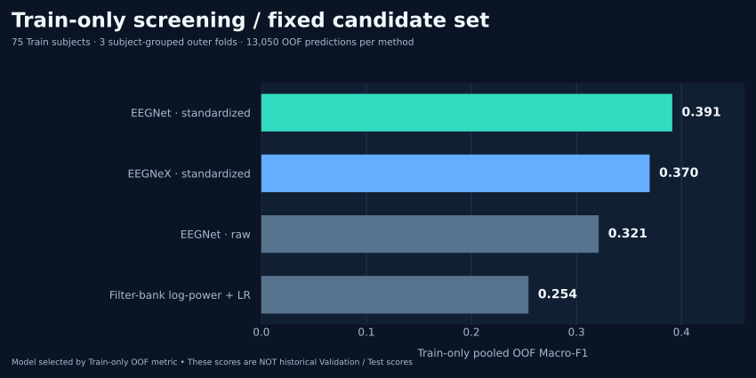
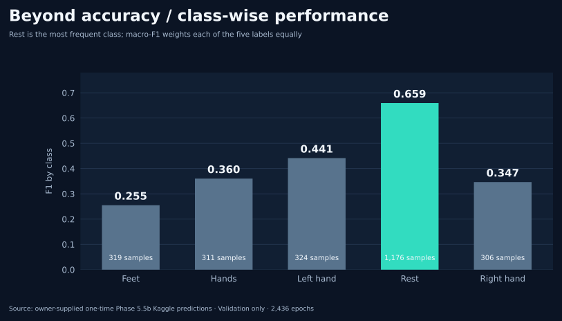
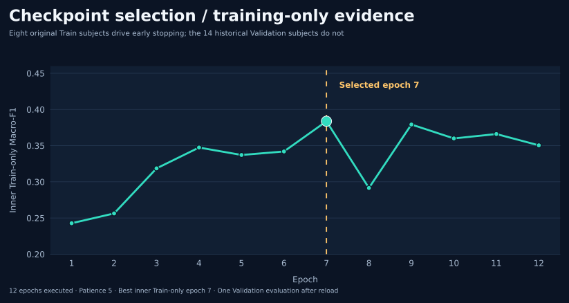

# Scientific visualization gallery

**All figures below are static, scalable SVGs created from recorded experimental metrics or the owner's independently audited 2026-10-13 Phase 5.5b Prediction ZIP.** None depicts held-out Test predictions; no synthetic benchmark points, interpolated experiments or extra model seeds were added to create the visuals.

[← Project overview](../README.md) · [Research findings and provenance](final-research-snapshot.md)

## 1 · Foundation vs EEG-specific models — original development Validation

**Data:** [Phase 3 EEGNet](../results/validation/phase3_validation_rerun_seed42_20261013.json), [Phase 4 LaBraM](../results/validation/phase4_validation_seed42_20261013.json), [Phase 5 CBraMod](../results/validation/phase5_cbramod_validation_seed42_20261013.json), [Phase 5.5b normalized EEGNet](../results/validation/phase55b_one_time_validation_seed42_20261013.json). All share the original 14 development-Validation participants and five classes, but model inputs/optimization methods differ. CBraMod Full predicted only `rest` and its accuracy must **not** be interpreted as successful decoding.

## 2 · Candidate selection was done on Train only

**Data:** [Phase 5.5a 75-Train-subject OOF audit](../results/validation/phase55_trainonly_oof_audit_20261013.json). These are **13,050 Train-only OOF predictions per model**, from three GroupKFold splits. Do **not** directly subtract these from the 14-person Validation metrics. The candidate selected here was later evaluated once on Validation without improving the historical EEGNet Macro-F1.

## 3 · Confusion matrix of the final normalized EEGNet

**Data:** [Phase 5.5b independent audit](../results/validation/phase55b_one_time_validation_seed42_20261013.json). Each cell shows a count and a fraction **within its true class**, so rows sum to 100%. Axis order: `feet`, `hands`, `left_hand`, `rest`, `right_hand`. Exactly 2,436 development Validation epochs from 14 participants.

## 4 · One mean can hide five different outcomes

**Data:** [Phase 5.5b empirical Prediction audit](../results/validation/phase55b_one_time_validation_seed42_20261013.json). `rest` is approximately 48.3% of Validation; class-balanced Macro-F1 is more informative than Accuracy alone. Per-class F1: 0.2551, 0.3604, 0.4414, 0.6593, 0.3466.

## 5 · Cross-subject heterogeneity

**Data:** [Phase 5.5b per-subject scores](../results/validation/phase55b_one_time_validation_seed42_20261013.json). There are 174 epochs per participant. Scores ranged from roughly **0.218 to 0.704**. The yellow pooled-score line is computed over all epochs and is **not** the arithmetic mean of the fourteen individual F1 values.

## 6 · Why epoch 7 was selected

**Data:** [Phase 5.5b epoch-history evidence](../results/validation/phase55b_one_time_validation_seed42_20261013.json). The **eight early-stop subjects are original Train participants**, never the fourteen held-out development Validation participants. Selected epoch: 7; twelve epochs executed, then patience exhausted. **No further epochs were trained** to create this figure.

## Historical interpretability and interface demonstrations

These older visual artifacts are retained separately and **are not evidence of the real Phase 3–5.5 prediction scores**.

| Archived attention rollout | Archived Gradio demonstration |
|---|---|
|  |  |

Attention ranking is **not a validated neural source localization**, and the Gradio screenshot needs an unavailable local checkpoint to reproduce as an interactive service. Its original large recording was removed from the current checkout to keep the final research snapshot lightweight; the immutable Git history retains the previous commit.

## Figure provenance and restrictions

The central charts were assembled from reviewed version-controlled JSON references and the final user ZIP with SHA-256 `8e88e4463d1fa96856cb127f57e4a706042ff441095ccb1c1ad5d9109f635391`. The final raw predictions and checkpoint weight binaries are **not committed**; only aggregate metrics, confusion counts and subject-level, public-dataset identifiers are displayed. Uncertainty intervals are exploratory subject-cluster bootstrap summaries, not multi-seed or independent Test verification. Scientific charts are illustrations of the reported data, not a claim of diagnostic efficacy.