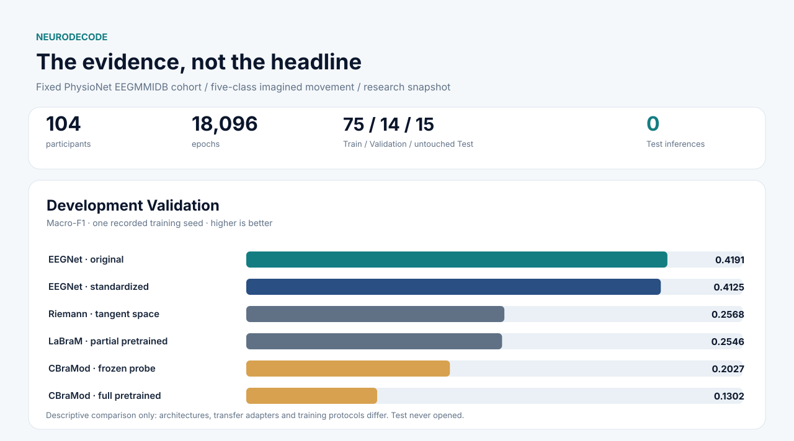
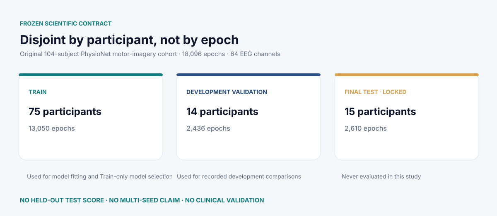
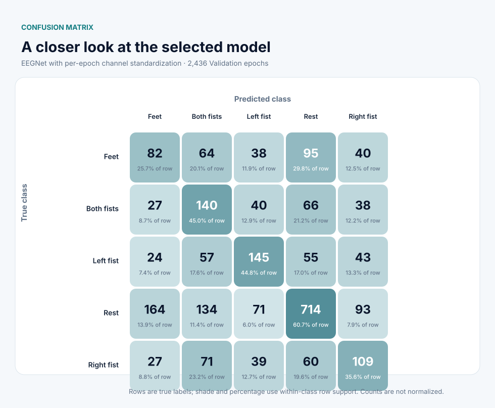
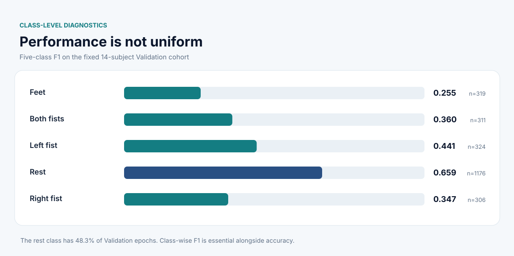
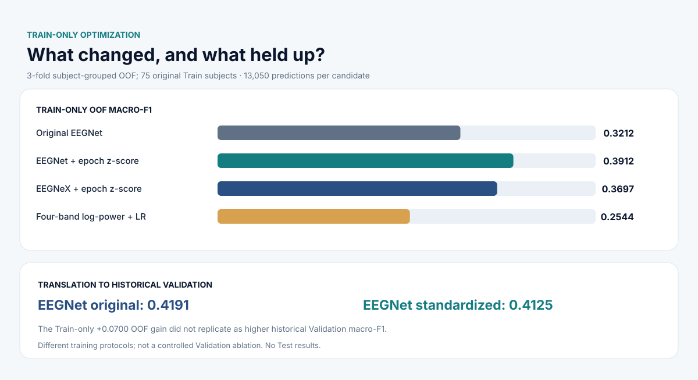
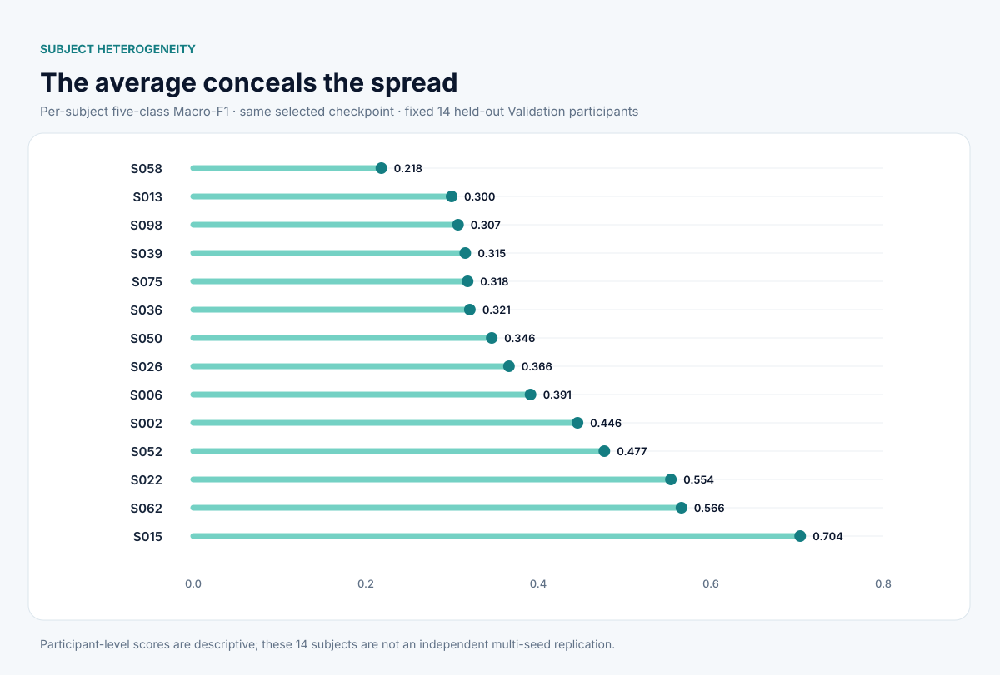
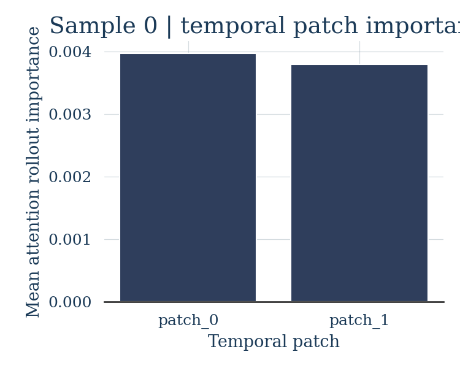

# Results visualization gallery

**Every chart in the first four sections is generated deterministically from committed, independently audited JSON evidence.** No images are decorative substitutes for missing model results. All scores are development-only, based on one recorded model seed. See [the generator](../scripts/render_final_figures.py) and [the final research summary](final-research-summary.md).

## 01 · Research overview



Development-Validation figures share the same frozen 14-participant subject list but their model input-adaptation and training regimes differ. **EEGNet original .4191** remains the highest recorded Macro-F1; normalized EEGNet achieved **.4125**. CBraMod Full **collapsed completely to Rest** despite apparently high accuracy.

## 02 · The methodological split



The displayed 15 Test subjects were never used for classification or tuning. **Test-locked is a study limitation, not a claim of Test generalization.**

## 03 · What the selected classifier gets wrong





The confusion matrix contains **raw counts** and percentages conditional on true class; dark shading indicates greater row-level recall, not absolute EEG confidence. Validation class support in order: Feet 319, Both fists 311, Left fist 324, Rest 1,176, Right fist 306.

## 04 · Normalization and subject heterogeneity





The +.0700 gain of normalization over raw EEGNet was measured within **Train-only out-of-fold screening**. On historic Validation the chosen normalized candidate gave **.4125**, below the earlier EEGNet **.4191**; the two Validation training protocols differ and should not be presented as an isolated normalization ablation. Subjectwise Macro-F1 spans **.218–.704**.

## 05 · Historical model inspection — not EEG physiology

| Attention-ranked canonical tokens/channels | Attention by temporal patch |
| :-- | :-- |
|  |  |

Attention rollout is **a model inspection visualization**, not validated physical-sensor importance, causal explanation or a cortical topography claim. The original demonstration used a different archived local checkpoint; these illustrations must not be attributed to the final normalized EEGNet model.

## 06 · Archived interactive demonstration


[Play the archived 24 MB demonstration video](../results/figures/phase4_gradio_demo/gradio_dashboard_demo.mp4). This historical UI is retained for visual completeness but requires a compatible private model checkpoint; it is **not a current deployed validated classifier**.

## Rebuild and verify the charts (no training)

From repo root:

```bash
python -m scripts.render_final_figures --check
python -m scripts.render_final_figures
```

The deterministic SVG generator reads *only* `results/validation/*.json`. It does **not** load raw EEG waveforms, use Test, require a GPU, infer new predictions, fit a model or create synthetic numbers. The repository quality workflow rejects charts that no longer match the committed source evidence.
